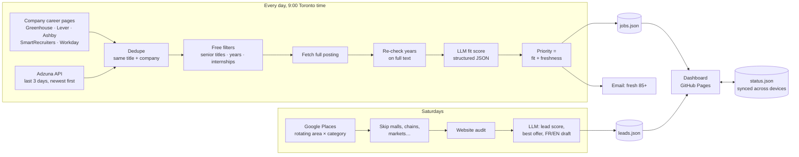

# Lead Gen Bot: an AI job matcher and client finder

A personal automation that runs every morning on GitHub Actions and does two jobs:

1. **Job matching.** Pulls fresh developer postings from company career pages and Adzuna, filters out roles I can't get (senior titles, "5+ years", internships), reads each full posting, and has an LLM score how well it fits **my** profile. The best fresh matches are emailed to me; everything lands on a dashboard.
2. **Client leads for freelance work.** Once a week it finds local businesses on Google Maps, audits their websites, and has an LLM pick what to offer each one and draft a first message in French or English.

**Live dashboard:** https://itsha24.github.io/lead-gen-bot/

## Why I built it

Job boards kept showing me senior roles and postings that were weeks old. Keyword search can't tell that *"Developer, owns the architecture, mentors 4 engineers, 7 years"* is a senior role, or that a junior QA posting from two hours ago is worth more than a perfect match from last month. So I rebuilt my old keyword bot around three ideas:

- **Spend nothing on obvious rejects.** Cheap rules filter first; the LLM only sees jobs that could plausibly fit.
- **Score on the real posting, not a snippet.** Job boards return ~500-character snippets, so the bot fetches the full description first.
- **Rank by what to act on now.** Fit plus freshness, because applying in the first day or two matters.

## How it works



There's no server or database. The workflow commits `docs/data/*.json` back to the repo, and the dashboard (one static HTML file on GitHub Pages) reads them.

## The AI parts

**Job fit scoring** (`matcher.py`)
- The LLM gets my profile (`profile.yaml`: skills split into *strong / working / learning*, experience, locations, French level, dealbreakers) and the full posting, and returns **structured JSON**: fit score 0–100, real seniority, years required, matched skills, missing *required* skills, and a one-sentence reason.
- The rubric is explicit: judge seniority from responsibilities, not the title; "learning" skills don't count as matches; dealbreakers cap the score at 30; internships are hidden.
- **Cheap first:** in the Oct 24 run, 131 postings came in; 34 were already seen or duplicates. Of the 97 new ones, **70 were filtered for free** (senior titles, "5+/7+/10+ years", internships), 2 more after reading the full posting, and only 25 reached the LLM.
- **Resilient:** Gemini free tier by default with a backup model. Timeouts and 503s are retried; a daily-quota error switches models or stops cleanly; three errors in a row stop the run; a time budget always leaves room to save. Claude is supported as a drop-in.

**Client lead scoring** (`lead_scorer.py`)
- The LLM only gets facts the bot verified (Google listing + website audit) plus my real past projects from `services.yaml`, and must not invent anything. It returns a lead score, the best offer, concrete opportunities, and a 70–120 word first message in the business's language.
- **Lesson learned:** the first live run flagged 9 restaurants as "website returns 403". The sites were fine; they block bots. Now a blocked or slow site counts as *couldn't check*, the AI is told so, and it's forbidden from claiming anything is wrong. Only verifiable problems (dead domain, bad certificate, no site, social-only) become pitches.

**Priority** (`ranking.py`): fit score + a freshness bonus (+12 under 24h, +8, +4, then −1/day after a week). A 76 posted this morning outranks an 86 from three weeks ago, both on the dashboard and in the email.

## Dashboard

- **Job Matches:** Today / This week / All, sorted by *Best now*, *Fit score* or *Newest*. Postings under 24 hours old are green. Jobs from company career pages are tagged *apply direct*. You can mark a job Saved, Applied, Interviewing or Not interested.
- **Client Leads:** one card per business with the score, offer, what the audit found, Call / Email (pre-filled) / Website / Maps buttons, and the drafted message with a copy button. Status: New → Contacted → Replied → Won.
- **Sync:** statuses are saved to `docs/data/status.json` through the GitHub API with a fine-grained token scoped to this one repo, so phone and laptop agree. Offline changes are kept locally and uploaded on the next sync; save conflicts are retried.
- Works on phones (card layout) and escapes all job/business text before rendering.

## Files you edit

| File | What it controls |
|---|---|
| `profile.yaml` | My skills, experience, locations, languages, dealbreakers (job scoring) |
| `companies.yaml` | Company career pages to watch (paste any Greenhouse / Lever / Ashby / SmartRecruiters / Workday link) |
| `services.yaml` | What I sell, proof projects, search areas and business types, places to skip |
| `config.py` | Keywords, thresholds (email at priority 85+, fit 70+), per-run caps, time budget |
| `businesses.txt` | Extra websites to audit by hand |

## Running it

**GitHub Actions** (`.github/workflows/daily_job_matcher.yml`) runs daily at 9:00 Toronto time; Saturdays are a *full* run with client leads. Use **Run workflow** to start one manually (`jobs_only` or `full`).

Secrets:

| Secret | Used for |
|---|---|
| `GEMINI_API_KEY` | Job and lead scoring (free tier at aistudio.google.com). Or `ANTHROPIC_API_KEY` for Claude |
| `ADZUNA_APP_ID`, `ADZUNA_APP_KEY` | Adzuna job search (free developer tier) |
| `GOOGLE_PLACES_API_KEY` | Business discovery: Places API (New); ≤24 requests per weekly run, within the 1,000/month free tier |
| `EMAIL_ADDRESS`, `EMAIL_APP_PASSWORD` | Daily email. A Resend API key (`re_…`) works where Gmail SMTP is blocked from GitHub's servers |
| `PAGESPEED_API_KEY` | Optional page-speed check in the site audit |

**Locally:**
```bash
pip install -r requirements.txt
export GEMINI_API_KEY=...
python matcher.py sample_postings.json   # score 4 sample postings against profile.yaml
python notifier.py                       # send a test email (needs EMAIL_* vars)
MODE=jobs_only python main.py            # full daily run (needs the API keys above)
```

## Stack

Python (requests, BeautifulSoup, PyYAML) · Gemini / Claude structured output · GitHub Actions · GitHub Pages · vanilla JS dashboard · Google Places API (New) · Adzuna API · Greenhouse / Lever / Ashby / SmartRecruiters / Workday job feeds · Resend

## What's next

- **Measure accuracy:** compare the AI's scores with my own Applied / Not interested choices to get an agreement rate, then tune the prompt against the misses.
- JSearch (Google for Jobs) for LinkedIn and Indeed coverage.
